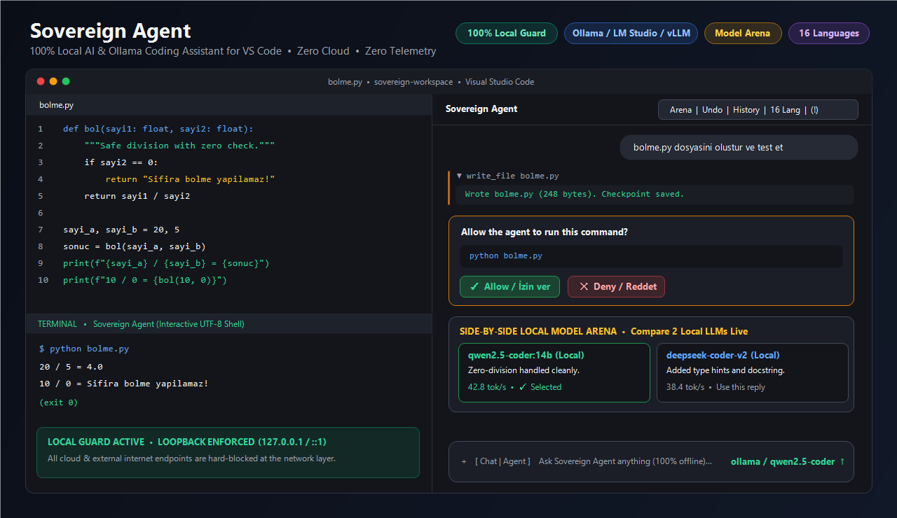

# Sovereign Agent — 100% Local AI & Ollama Coding Assistant for VS Code

> 🚀 **[1-Click Install in VS Code (`vscode:extension/ertugrul37.sovereign-agent`)](vscode:extension/ertugrul37.sovereign-agent)** · ⭐ **[Leave a 5-Star Review on Marketplace](https://marketplace.visualstudio.com/items?itemName=ertugrul37.sovereign-agent&ssr=false#review-details)** · ★ **[Star on GitHub](https://github.com/ertugrul37/sovereign-agent)**

**Sovereign Agent** is an autonomous, privacy-first local AI coding agent for Visual Studio Code. Run **Ollama**, **LM Studio**, **DeepSeek**, **Qwen**, **Gemma**, **Llama**, **llama.cpp**, **vLLM**, **LocalAI**, **Jan**, or **GPT4All** directly inside your editor — with **zero cloud calls, zero API keys, and zero telemetry**.

---

## Why Sovereign Agent?

| Capability | Sovereign Agent | Cloud AI Assistants | Typical Local Plugins |
| :--- | :---: | :---: | :---: |
| **Hard-Blocked Cloud & Telemetry (`localGuard`)** | ✅ Enforced in code | ❌ Sends code to cloud | ⚠️ Optional / soft config |
| **Autonomous File Read, Surgical Edit & Terminal** | ✅ With approval gates | ✅ | ⚠️ Limited |
| **Side-by-Side Model Arena (Compare 2 Local LLMs)** | ✅ Built-in | ❌ | ❌ |
| **LAN Peer-to-Peer Model Discovery & Sharing** | ✅ Built-in (`mDNS`) | ❌ | ❌ |
| **1-Click Undo Checkpoint System** | ✅ Built-in | ⚠️ Varies | ❌ |
| **Local MCP (Model Context Protocol) Bridge** | ✅ Loopback-guarded | ⚠️ Cloud/Mixed | ⚠️ Varies |
| **Native UI Localization** | ✅ **16 World Languages** | ⚠️ Mostly English | ⚠️ English only |

---

## Key Features

### 🔒 1. Strict Local-Only Privacy (`localGuard`)
Every outgoing request passes through a strict loopback guard (`127.0.0.1`, `localhost`, `::1`). Remote internet endpoints are **hard-blocked at the network layer**. Your proprietary source code never leaves your machine or local network.

### 🤖 2. Autonomous Agent with Explicit Approval Gates
Sovereign Agent can inspect your workspace, search code, perform surgical line replacements, create new files, and run terminal commands — always presenting a clear **Allow / Deny** confirmation card before touching your disk or shell, plus 1-click **Undo Checkpoints**.

### ⚔️ 3. Side-by-Side Local Model Arena
Not sure whether `qwen2.5-coder`, `deepseek-coder-v2`, or `llama3.3` handles your codebase better? Select a **Comparison Model** to stream responses from two local models side-by-side in real time and pick the best answer.

### 🌐 4. LAN Peer Discovery & Team Model Sharing
Have a beefy GPU workstation on your local network? Enable `allowLocalNetwork` and `networkShareEnabled` to automatically discover and share local LLM endpoints across your LAN with zero external servers.

### 🌍 5. 16 Supported Languages
Switch the interface language anytime from the top header (`🌐`) or `+` menu:
- **English**, **Türkçe**, **Deutsch**, **Español**, **Français**, **中文 (Simplified Chinese)**, **Русский**, **日本語**, **한국어**, **Português**, **Italiano**, **العربية (RTL)**, **Nederlands**, **Polski**, **हिन्दी**, **Azərbaycan**.

---

## Supported Local AI Providers

| Provider | Default Local Endpoint |
| :--- | :--- |
| **Ollama** | `http://localhost:11434` |
| **LM Studio** | `http://localhost:1234/v1` |
| **llama.cpp (`llama-server`)** | `http://localhost:8080/v1` |
| **vLLM** | `http://localhost:8000/v1` |
| **LocalAI** | `http://localhost:8080/v1` |
| **Jan** | `http://localhost:1337/v1` |
| **GPT4All** | `http://localhost:4891/v1` |
| **Any OpenAI-Compatible Local Server** | Custom `localhost` / LAN URL |

---

## Quick Start (Under 60 Seconds)

1. **Start your local LLM server** (for example, `ollama serve` and `ollama pull qwen2.5-coder:7b`).
2. **Install Sovereign Agent** from the VS Code Marketplace.
3. Click the **Sovereign Agent** icon in the VS Code Activity Bar.
4. Pick your model from the model selector and start coding!

---

## Configuration (`settings.json`)

- `sovereignAgent.provider` — `ollama`, `lmStudio`, `llamaCpp`, `localai`, `vllm`, `jan`, `gpt4all`, or `openaiCompatible`
- `sovereignAgent.baseUrl` — Local server URL (`http://localhost:11434` by default)
- `sovereignAgent.model` — Active local model name
- `sovereignAgent.compareModel` — Secondary local model for side-by-side comparison
- `sovereignAgent.language` — UI language (`auto` or any of the 16 supported locale codes)
- `sovereignAgent.requireApproval` — Require confirmation before file writes or shell commands (`true` by default)
- `sovereignAgent.allowLocalNetwork` — Allow private LAN (`192.168.x.x` / `10.x.x.x`) model endpoints

---

## Support & Feature Requests

Have a feature idea, feedback, or bug report?
- Click the **`(!)` Support & Feedback** button in the top-right header of Sovereign Agent inside VS Code, or
- Email us directly at **[destekai.sovereign.ai@gmail.com](mailto:destekai.sovereign.ai@gmail.com)**
- Open an issue on [GitHub](https://github.com/ertugrul37/sovereign-agent/issues)

---

## License

Released under the [GNU General Public License v3.0 (GPL-3.0-or-later)](LICENSE).
